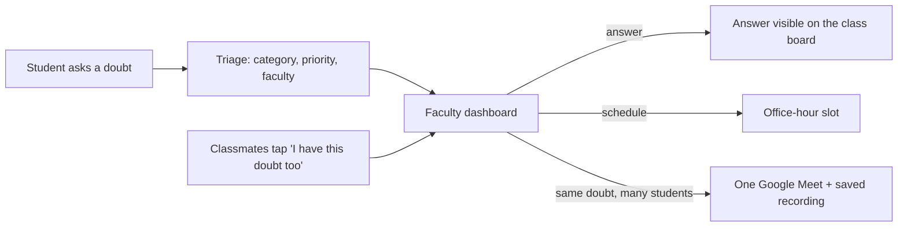

# Heard in Class, Lost After

**A faculty–student doubt-resolution platform.** Students ask academic questions with course context, the system triages and routes each one to the right faculty, and faculty answer, schedule office hours, or run **one Google Meet for every student who has the same doubt** and save the recording for everyone.


> Project **P09 – Heard in Class, Lost After** (Faculty–Student Communication).

<!-- Tip: add screenshots to a docs/ folder and link them here, e.g.  -->

---

## Table of contents

- [The problem](#the-problem)
- [Features](#features)
- [Tech stack](#tech-stack)
- [Quick start](#quick-start)
- [Try it in 2 minutes](#try-it-in-2-minutes)
- [Run with Docker](#run-with-docker)
- [Configuration](#configuration)
- [Customising courses, faculty and users](#customising-courses-faculty-and-users)
- [Smart matching with Ollama (optional)](#smart-matching-with-ollama-optional)
- [Group sessions and recordings (Google Meet)](#group-sessions-and-recordings-google-meet)
- [How triage works](#how-triage-works)
- [Authentication and authorization](#authentication-and-authorization)
- [Project structure](#project-structure)
- [API reference](#api-reference)
- [Troubleshooting](#troubleshooting)
- [Limitations](#limitations)
- [Before real use](#before-real-use)

---

## The problem

Students struggle to get doubts or decisions resolved outside class, while faculty receive large volumes of unstructured requests through many channels (WhatsApp, email, in person). Many of those requests are the **same doubt asked by different students**.

## Features

The app is built around the three modules from the problem statement:

| Module | What it does | Where |
|---|---|---|
| **1. Student Query Service** | Submit questions with course info, track status, see answers, Meet links and recordings. A shared **class doubt board** shows what classmates asked. | `/student` |
| **2. Faculty Response Service** | See queries ordered by priority, filter by status, answer, schedule a slot, or open a group session. | `/faculty` |
| **3. Triage & Appointment Service** | Auto-categorises each query, sets priority, routes it to the faculty of that course, and finds similar doubts. | `lib/triage.js` |

**Integration:** student query → triage and routing → faculty response, appointment or group session.



**Highlights**

- **Login with roles:** separate student and faculty accounts, checked on the server for every page and every API call.
- **Class doubt board:** students see public doubts of the courses they are enrolled in, **anonymously**, and can tap **"I have this doubt too"** instead of posting a duplicate.
- **Private doubts:** any question can be marked private. Marks and attendance questions are always private.
- **Similar-doubt suggestions:** while a student types, matching doubts already on the board are suggested.
- **Group sessions:** faculty select students with the same doubt and create one Google Meet. Everyone who asked or tapped "me too" gets the link. The recording link is saved and shown to all of them.
- **Smart matching (optional):** with a local Ollama, similar doubts are matched by *meaning*, not just shared words. Without it, the app falls back to keywords automatically.

## Tech stack

- **Next.js 14.2** (App Router) and **React 18**, plain JavaScript and plain CSS (no UI library)
- **JSON files** for storage (no database to install)
- **Node `crypto`** for password hashing (scrypt) and signed session cookies (HMAC), no auth library
- **Ollama** with `nomic-embed-text` for optional meaning-based matching
- **Docker / Docker Compose** for one-command deployment

## Quick start

### Prerequisites

| Tool | Needed for | Notes |
|---|---|---|
| **Node.js 18.17 or newer** and npm | running the app | developed and tested on Node 22 |
| Git | cloning | or just download the ZIP |
| Docker + Docker Compose | the Docker option | optional |
| [Ollama](https://ollama.com) | meaning-based matching | optional, see [below](#smart-matching-with-ollama-optional) |
| A Google account | creating Meet links | faculty only; recording needs a Workspace plan that allows it |

### Run locally

```bash
# 1. get the code
git clone https://github.com/<your-username>/<your-repo>.git
cd <your-repo>

# 2. install dependencies
npm install

# 3. (optional) create your settings file
cp .env.example .env

# 4. start the dev server
npm run dev
```

Open **http://localhost:3000** and log in with a [demo account](#try-it-in-2-minutes).

The `data/` folder (queries, sessions, users) is created automatically on first use.

**Production build without Docker**

```bash
npm run build
npm start            # http://localhost:3000
```

Use another port with `npm run dev -- -p 4000` or `npm start -- -p 4000`.

### npm scripts

| Script | What it does |
|---|---|
| `npm run dev` | development server with hot reload |
| `npm run build` | production build |
| `npm start` | run the production build |
| `npm run check:ollama` | checks that Ollama and the model are ready, and tunes the match threshold |

## Try it in 2 minutes

**Demo accounts** (created automatically on first run, passwords are stored hashed):

| Role | Username | Password | Enrolled in |
|---|---|---|---|
| Student (Asha) | `101` | `student123` | CSE310, CSE326 |
| Student (Ravi) | `102` | `student123` | CSE310, MTH174 |
| Student (Meera) | `103` | `student123` | CSE326, MTH174 |
| Faculty (Dr. Sharma) | `sharma` | `faculty123` | teaches CSE310 |
| Faculty (Prof. Singh) | `singh` | `faculty123` | teaches CSE326 |
| Faculty (Dr. Kaur) | `kaur` | `faculty123` | teaches MTH174 |

Pick **Student** or **Faculty** on the login page. A student account on the Faculty tab is refused.

> The login cookie is shared by all tabs of a browser. To play two users at once, use a **private/incognito window** or a second browser.

**Walkthrough**

1. Log in as student **101**. Ask in **CSE310**: *"How does binary search work on a sorted array?"* The toast shows it was routed to **Dr. Sharma**.
2. In a private window, log in as student **102**. Open **Class Doubts**: Asha's doubt is there, shown as "a classmate". Tap **🙋 I have this doubt too**. (Student **103** is not in CSE310 and sees nothing.)
3. In another window, log in as faculty **sharma**. The query shows *"1 classmate has this too"*. Tick it, fill in a title and time, click **Create Google Meet** (opens `meet.google.com/new`), paste the link, and click **Create Session**.
4. Student 102 now sees a **Join Google Meet** card although they never posted anything.
5. Back as faculty, open **Group Sessions**, paste a recording link, click **Save Recording**. Both students see **Watch the recording** and their queries become **Answered**.

## Run with Docker

```bash
cp .env.example .env     # set AUTH_SECRET to your own long random value
docker compose up --build
```

Open **http://localhost:3000**.

```bash
docker compose down        # stop (data is kept)
docker compose down -v     # stop AND delete all data
```

- Data lives in the `p09-data` Docker volume, so it survives restarts and rebuilds.
- After pulling new code, run `docker compose up --build` again, otherwise the old image is reused.
- To use another host port, change `"3000:3000"` in `docker-compose.yml` (for example `"8080:3000"`).
- `docker-compose.yml` reads `AUTH_SECRET`, `COOKIE_SECURE`, `EMBED_URL`, `EMBED_MODEL` and `SIMILARITY_THRESHOLD` from your `.env`.

## Configuration

Settings are environment variables. Put them in a `.env` file in the project root (copy `.env.example`). Next.js loads it automatically.

| Variable | Default | Purpose |
|---|---|---|
| `AUTH_SECRET` | `dev-secret-change-me` | Signs login cookies. **Set your own long random value for any real use.** |
| `COOKIE_SECURE` | `false` | Set to `true` when the site is served over https. |
| `EMBED_URL` | `http://localhost:11434` | Where Ollama runs. Docker default: `http://host.docker.internal:11434`. |
| `EMBED_MODEL` | `nomic-embed-text` | Embedding model used for meaning-based matching. |
| `SIMILARITY_THRESHOLD` | `0.65` | 0 to 1. Higher means stricter matching. |
| `EMBED_TIMEOUT_SECONDS` | `8` | How long to wait for Ollama before falling back to keywords. |
| `EMBED_RETRY_SECONDS` | `30` | After Ollama fails, how long to wait before trying again. |

`EMBED_TIMEOUT_SECONDS` and `EMBED_RETRY_SECONDS` apply to local runs; `docker-compose.yml` does not pass them through.

Generate a good secret with: `openssl rand -hex 32`

## Customising courses, faculty and users

| I want to... | Edit |
|---|---|
| change which faculty teaches a course | `courseFaculty` in `lib/triage.js` |
| add or edit demo users, passwords, student courses | the `seed` list in `lib/users.js` |
| change categories, priority words, or what counts as private | `lib/triage.js` |

Notes:

- A faculty user's `name` in `lib/users.js` must **exactly match** the name used in `courseFaculty`, because queries are routed by name.
- A student only sees and posts to the courses listed in their `courses`.
- Users are written to `data/users.json` **once**. After editing the `seed`, **delete `data/users.json`** (and restart) to regenerate users. This resets all user accounts.

## Smart matching with Ollama (optional)

The app finds similar doubts in two places: the suggestions shown while a student types, and the faculty "similar doubts" badges and **Select all similar** button.

- **Without Ollama:** matching uses shared keywords. This works out of the box.
- **With Ollama:** matching uses *meaning*, so *"Explain searching an ordered list by halving"* finds *"How does binary search work on a sorted array?"*. The text is processed on your own machine and is not sent to an outside service.

**Set it up**

```bash
# 1. install Ollama from https://ollama.com and start it
ollama serve                      # or: sudo systemctl start ollama

# 2. download the small embedding model (once)
ollama pull nomic-embed-text

# 3. check that everything works
npm run check:ollama
```

`npm run check:ollama` tests the connection and the model. It also scores a "same doubt, different words" pair against an "unrelated" pair and recommends a `SIMILARITY_THRESHOLD` if the default does not separate them well. Restart the app afterwards.

**How to tell it is on:** the faculty page says *"Similar doubts are matched by meaning (AI)"* instead of *"keywords only"*.

**With Docker:** the container reaches Ollama on your machine through `host.docker.internal:11434` (already configured). On Linux, Ollama listens only on localhost by default, so allow connections from the container:

```bash
sudo systemctl edit ollama        # add the two lines below, then save
#   [Service]
#   Environment="OLLAMA_HOST=0.0.0.0"
sudo systemctl restart ollama
```

This makes Ollama reachable from your network, so firewall port `11434` if that matters.

**Privacy:** the faculty side also compares students' *private* questions. Keep `EMBED_URL` pointing at a machine you control. Embeddings are cached in `data/embeddings.json`, so each question is embedded only once. If Ollama stops, the app quietly switches back to keywords.

## Group sessions and recordings (Google Meet)

1. Faculty tick students' queries with the same doubt (or click **Select all similar**).
2. Click **Create Google Meet**. This opens `meet.google.com/new`. Copy the meeting link and paste it into the form, then set a title and time.
3. Everyone who asked, plus everyone who tapped *"I have this doubt too"*, sees a **Join Google Meet** card. A student who taps "me too" *after* the session was created joins it automatically.
4. During the meeting the faculty starts recording in Meet (**Activities → Recording**). Meet saves the file to the organiser's Google Drive.
5. Faculty paste the Drive link into the session. All students in it can watch it, and their queries are marked **Answered**.

What is automatic and what is not:

- The Meet link is created **manually** (button + paste). Creating it automatically needs a Google Cloud project with OAuth and the Calendar API, which this project does not include.
- Recording is started by the teacher in Meet, and the Drive link is pasted manually. Meet recording is only available on some Google Workspace plans, so check that your institution's accounts allow it.

## How triage works

All rules are plain keyword checks in `lib/triage.js`. The first matching rule wins, in this order:

| Category | Matches words like |
|---|---|
| Exam / Marks | exam, marks, result, grade, paper |
| Assignment | assignment, submission, deadline, project |
| Attendance | attendance, leave, absent, medical |
| Meeting Request | meet, appointment, office hour, discuss |
| Concept Doubt | everything else |

- **High priority:** the text contains *urgent, today, tomorrow, asap* or *deadline*. High-priority queries are listed first.
- **Routing:** the query goes to the faculty mapped to its course in `courseFaculty`.
- **Private automatically:** *Attendance* and *Exam / Marks* queries are never shown on the class board.

## Authentication and authorization

- **Every page checks the login on the server, on every request.** Logged-out visitors are sent to `/login`. Logged-in users are sent away from `/login` to their own dashboard. A student cannot open `/faculty` and faculty cannot open `/student`.
- **Pages are never cached** (`force-dynamic`, `no-store`, router `staleTimes.dynamic = 0`), so the back button cannot show an old page after logout.
- **Sessions are stored on the server** (`data/auth-sessions.json`). Logout deletes the session, so a copied cookie stops working. Sessions expire after 8 hours.
- **Open tabs stay in sync:** logging out in one tab sends the others to `/login`; logging in in one tab moves an open login page to the dashboard.
- **API routes re-check the role on every request.** Students only see their own queries. Faculty only see queries assigned to them and can only change their own sessions.
- **Passwords** are hashed with scrypt. After 5 wrong passwords an account is locked for 1 minute.
- **Cookies** are `httpOnly` and `SameSite=Lax`. Set `COOKIE_SECURE=true` over https.
- **Privacy on the class board:** other students never receive the asker's name or roll number, and private doubts are never sent to them.

## Project structure

```
.
├── app/
│   ├── page.js                    # home page
│   ├── layout.js                  # navbar + login-state sync for every page
│   ├── globals.css                # all styling (plain CSS)
│   ├── login/                     # login page (server check) + LoginForm
│   ├── student/                   # student page (server check) + StudentView
│   ├── faculty/                   # faculty page (server check) + FacultyView
│   └── api/
│       ├── login/  logout/  me/   # authentication
│       ├── queries/               # submit, list, answer, "me too"
│       ├── board/                 # class doubt board + suggestions while typing
│       └── sessions/              # group sessions and recordings
├── components/
│   ├── Navbar.js                  # server-rendered navbar
│   ├── LogoutButton.js
│   └── AuthSync.js                # keeps open tabs in sync with the login state
├── lib/
│   ├── triage.js                  # categories, priority, routing, keyword matching
│   ├── embeddings.js              # optional Ollama meaning-based matching
│   ├── board.js                   # what a student may see on the board
│   ├── users.js                   # demo users, password hashing, enrolled courses
│   ├── auth.js                    # sessions, cookies, role checks
│   ├── token.js                   # signed cookie (also runs in middleware)
│   └── db.js                      # JSON file storage
├── middleware.js                  # cheap first check of the cookie signature
├── scripts/check-ollama.js        # npm run check:ollama
├── Dockerfile  docker-compose.yml  .dockerignore
├── .env.example  .gitignore
└── next.config.js
```

**Data files** (created in `data/`, ignored by git): `queries.json`, `sessions.json`, `users.json`, `auth-sessions.json`, `embeddings.json`.

## API reference

All routes need a login unless noted. "Student" and "faculty" mean the role is enforced.

| Method | Path | Who | Purpose |
|---|---|---|---|
| `POST` | `/api/login` | anyone | Log in (`username`, `password`, `role`) |
| `POST` | `/api/logout` | logged in | End the session |
| `GET` | `/api/me` | logged in | Current user |
| `GET` | `/api/queries` | student / faculty | Student: own queries. Faculty: queries assigned to them |
| `POST` | `/api/queries` | student | Submit a query (triaged automatically) |
| `PATCH` | `/api/queries/:id` | faculty | Answer or schedule a slot (assigned faculty only) |
| `POST` | `/api/queries/:id/metoo` | student | Toggle "I have this doubt too" |
| `GET` | `/api/board` | student | Public doubts from the student's courses |
| `POST` | `/api/board/similar` | student | Similar doubts for the text being typed |
| `GET` | `/api/sessions` | student / faculty | Sessions the user is part of / owns |
| `POST` | `/api/sessions` | faculty | Create a group session from selected queries |
| `PATCH` | `/api/sessions/:id` | faculty | Save the recording link (session owner only) |

## Troubleshooting

| Problem | Fix |
|---|---|
| **"Wrong username or password"** after editing `lib/users.js` | Delete `data/users.json` and restart so users are re-created. |
| **"Too many failed attempts"** | 5 wrong passwords lock that username for 1 minute. Wait, or restart the server. |
| **A student sees an empty class board** | They only see courses they are enrolled in. Student `103` is not in CSE310. Check `courses` in `lib/users.js`. |
| **Logged out unexpectedly** | The session was removed, or `AUTH_SECRET` changed, or `data/auth-sessions.json` was deleted. Log in again. |
| **Port 3000 is already in use** | `npm run dev -- -p 3001` (Docker: change the port mapping). |
| **Faculty page says "keywords only"** | Ollama is not reachable. Run `npm run check:ollama` and follow its hints. |
| **Docker cannot reach Ollama** | Ollama must listen on all interfaces (`OLLAMA_HOST=0.0.0.0`). See [Smart matching](#smart-matching-with-ollama-optional). |
| **Changes not showing in Docker** | Run `docker compose up --build`. |
| **Start fresh** | Stop the app and delete the `data/` folder (Docker: `docker compose down -v`). |
| **`npm audit` reports vulnerabilities** | Expected for the 14.x line, see [Before real use](#before-real-use). Do not run `npm audit fix --force`, it jumps to a new Next.js major version that this code has not been migrated to. |
| **Form fields clear right after opening a page in `npm run dev`** | The dev server reloads a page once after compiling it for the first time. Wait a second and retype. Production builds do not do this. |
| **`npm install` or build errors** | Check `node -v` is 18.17 or newer, then delete `node_modules` and `.next` and reinstall. |

## Limitations

- **Storage is JSON files.** Fine for a demo or a small class, not for many simultaneous users. Run a single instance only, because the login-attempt counter is kept in memory and the files are not safe for concurrent servers.
- **Demo accounts only.** There is no sign-up page or password reset.
- **Google Meet is manual:** the link and the recording link are pasted by the teacher.
- **No notifications:** students see updates when they open the app (use the Refresh button). There are no emails or push messages.
- **No automated test suite** is included in this repository yet.

## Before real use

- [ ] Set your own `AUTH_SECRET` in `.env` (for example `openssl rand -hex 32`).
- [ ] Serve the app over **https** and set `COOKIE_SECURE=true`.
- [ ] Replace the demo accounts. Move users, queries and sessions into a real database.
- [ ] Keep `EMBED_URL` pointing at a machine you control, because private questions are read by the matcher.
- [ ] Back up the `p09-data` volume (or the `data/` folder).
- [ ] **Plan an upgrade to a current Next.js major version.** This project uses Next.js 14.2.35, the last 14.x release, which fixes the serious issues of earlier 14.x versions (including the middleware authorization bypass). `npm audit` still lists advisories that are only fixed in newer majors, mostly denial-of-service issues. The image optimizer is switched off (`images.unoptimized` in `next.config.js`) and this app uses no rewrites or Server Actions, but a public deployment should move to a supported major version.
